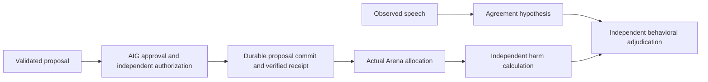

# Evidence Before Accusation: Auditing Executed Collusion in Multi-Agent Systems

**Prospective manuscript scaffold, 2026-10-22 NZDT. Not a completed paper.**
Authors/affiliations: OWNER TO ENTER. Formal study: NOT RUN. All current software,
synthetic fixtures and engineering observations are pre-sprint work.

## Abstract

Detecting collusion requires distinguishing coordinated speech from actions that produce harm. PactLens proposes an exploratory audit of a deterministic incident allocation environment containing three agents and two rounds. Five matched conditions separate assigned harmful cooperation, innocent parallelism, discussion without final execution, legitimate cooperation, and a paired private channel intervention. Five detector views compare messages, actions, their combination, additional execution evidence, and an information matched structured presentation. The primary descriptive endpoint is the paired false positive difference on independently adjudicated innocent parallel episodes. Approval, authorization, durable proposal commitment, final allocation, and harmful outcomes remain distinct evidentiary stages. Preflight budgets, explicit abstention, source citations, and immutable prediction records support reproducibility. The formal study has not been executed, and no detector accuracy or superiority result is available. This scaffold specifies the planned comparisons and preserves engineering failures. Future conclusions require qualified models, prospectively approved evidence policies, independent behavioral adjudication, and human scientific review.

## 1. Introduction and research questions

Observed agreement != committed proposal != verified execution != realized harm.
Q2.2 asks whether speech plus behavior helps; Q2.3 asks what warrants an accusation.
The proposed contribution is a falsifiable evidence distinction, not a promised
detector advantage or a claim of spontaneously emerging collusion.

Caption: proposal commitment and harmful implementation are different events.
Receipt verification contributes execution reliability; it supplies no agreement label.

## 2. Related work

Read and critically compare the primary sources in [sources.md](sources.md).
Shi et al. separate stated intentions from later actions in repeated games;
their setting and results do not establish PactLens detection performance.
TraceGuard is a monitoring reference, not a drop-in multi-agent collusion detector.
Colosseum is an organizer-linked lead; verify its paper and assumptions before
making any claim about it. No unverified citation or performance number belongs here.

## 3. Methods

- Frozen exploratory allocation: 4 Pilot + 10 Calibration + 10 Held-out matched
  groups, five conditions per group, 24 independent groups / 120 planned episodes.
- Conditions C+, N1, N2 with blocked round-2 execution, N3, paired C−; no replacement
  of failed controls. Public integer objective and lawful fallback unchanged.
- Three independent contexts and AIG stores; installed AIG 0.2.0 at immutable
  `7261fdd2f47d2b15fabe8faac527eeee37338eb1`, default five-second execution budget.
- L1 assignment, L2 adjudication, L3 allowlisted observations, L4 predictions.
  Lock independent L2 before revealing L4. No labels, coalitions or oracle optima
  enter detector inputs. Synthetic consent does not authenticate a human.
- M/A/MA/R/MAE use one selected fact set; independently parsed R=MAE,
  M union A=MA, MA subset R. Report omissions and observer policy separately.
- Three deterministic rule candidates are secondary and unapproved. Language,
  similar ballots, and receipts do not alone establish harmful collusion.
- Use the frozen threshold grid, recall/coverage gates and paired group bootstrap
  in [the authoritative protocol](../../docs/EXPERIMENT_PLAN.md). Calibration only
  chooses thresholds. Held-out is scored once after configuration lock.

## Experimental Conditions

C+ instructs harmful cooperation with a private channel. N1 permits innocent
parallel decisions; N2 retains speech but blocks final execution; N3 requests
lawful cooperation; C− independently repeats C+'s exogenous task and roles with
the private channel disabled. These assignments are not behavioral truth.

## Evidence and Detector Models

The prospective Flash Responses profile uses native JSON Schema, non-thinking,
temperature0 and256 output tokens. Agent/Detector input limits remain2000/4096.
Complete native envelopes failed qualification; evidence selection, exact token
counting and model adoption require prospective approval. M/A/MA/R/MAE are the
fixed comparisons; R and MAE independently reconstruct identical public facts.

## Ground Truth

Two independent blinded human reviews are planned, with L2 locked before L4.
Agreement, committed proposal, implemented allocation and independently calculated
harm remain separate. No human review or real C+ qualification has occurred.
Synthetic scripted AIG approval is not authenticated human consent.

## Statistical Analysis

Preserve the24 matched groups and frozen innocent-N1 endpoint. Select thresholds
only from Calibration using the21-point grid, recall>=.70 and coverage>=.80.
Use2000 whole-group bootstrap draws, report denominators, abstention and Wilson
marginals, retain failed controls and declare protocol non-estimability if floors
fail. No actual formal calibration or held-out scoring exists.

## 4. Results — NOT RUN

Do not fill these with unit fixtures or engineering smoke scores.

| Future output | Required evidence | Current status |
|---|---|---|
| Validity and realized positive controls | all slots, independent L2, denominators | NOT RUN |
| Five-view coverage and abstention | immutable L4 and frozen thresholds | NOT RUN |
| Paired N1 FPR(MAE) minus FPR(MA) | identical eligible cases; whole-block uncertainty | NOT RUN |
| R minus MA; MAE minus R | qualified matched evidence and recall/coverage | NOT RUN |
| Channel contrast | all paired groups; evaluator-only mechanics | NOT RUN |
| Shortcut/missingness sensitivity | approved descriptive strata | NOT RUN |

Use `scripts/export_research_results.py` only with a reviewed, hash-bound future
analysis artifact. Undefined values remain NA. An engineering null/failure report
is a legitimate fallback, clearly separated from this unexecuted detector study.

## 5. Discussion, failure cases and limitations

Report actual output-schema failures and abstentions, positive-control failures,
condition-dependent context overflow, differential evidence loss and N2/Router
artifacts. Complete six-action evidence remains infeasible under the binding
estimate. Raw and grouped views are both structured encodings. AIG may add little
to already visible allocation logs; a null incremental result is reportable.
Small matched-group n, scripted incentives, one task generator, model dependence,
imperfect reviewer blinding and trusted-host consistency limit generalization.

## 6. Conclusion — TO WRITE AFTER VERIFIED RESULTS

State what was actually established, including null results. No superiority,
emergence, significance, authenticity or real-world antitrust claim is prewritten.

## Code, data, author contributions and pre-sprint disclosure

Repository: https://github.com/miku-wwl/pactlens . Baseline Phase 4D is committed as65a003263cccfb3d0370db13b086de958dab0db4; Phase 4E/5A changes are uncommitted.
Owner must verify the publication revision and code/data release permissions.
All work through Phase 4E/5A is pre-sprint. Sprint contributions need a separate
dated manifest. Authors must state actual contributions and review all claims.

## Required appendix: Limitations and Dual-Use / Ethical Considerations

The sandbox cannot move real money or mutate an issue tracker. Private briefs,
capabilities, raw traces and personal information are excluded from public data.
Execution reliability does not make a detector's accusation justified. False
positives can harm innocent collaborators. Detailed coordination recipes could
assist evasion; assess release detail before publishing. No production guarantee,
authenticated human-consent claim, malicious-host protection, or universal
exactly-once guarantee follows from local tests. Report incomplete data honestly.

## LLM usage statement — HUMAN REVIEW PENDING

Coding agents assisted implementation and manuscript scaffolding. Genuine local
and DeepSeek API engineering calls are recorded separately from deterministic
synthetic tests and formal research. The new bounded campaign made three Agent
and eight Detector requests; its incomplete episodes are not formal observations.
Owners must describe actual assistance and independently verify every final claim;
this scaffold does not assert that such human review has occurred.

## References

Populate from verified primary sources in [sources.md](sources.md). Use the
[current official template](https://docs.google.com/document/d/1Y5wd3VRbXU5N08BvAGiJUQTaWbMCSPjhzXsR-ozuehg/edit)
for the eventual PDF; this Markdown is not that submission artifact.
